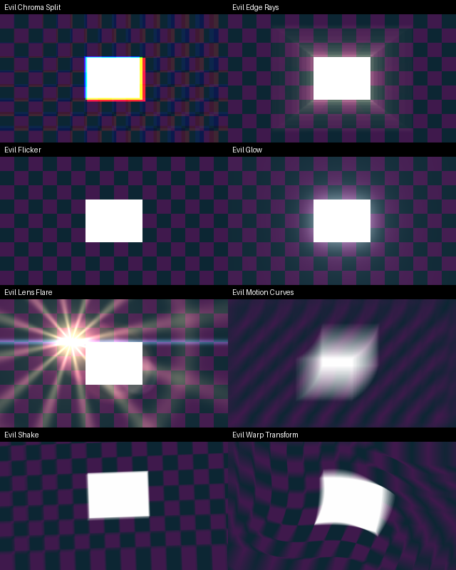

<h1 align="center">EVILEFFECTS</h1>

<p align="center">
  <b>Heavy-hitting effect plug-ins for <a href="https://github.com/storytold/effectcraft">EffectCraft</a>, the open-source motion graphics app.</b>
</p>

<p align="center">
  <a href="https://discord.gg/AGfaBwNKfN"></a>
  <a href="https://www.youtube.com/@EvelopmentGames"></a>
  <a href="https://www.instagram.com/evelopmentgames/"></a>
  <a href="http://onee.page/evelopmentgames"></a>
  
</p>

<p align="center">
  <a href="https://ko-fi.com/evelynnevlmg"></a>
</p>

## Effects

They show up in EffectCraft's Effects & Presets panel under **EVILEFFECTS**.

<p align="center">
  
</p>

| Effect | What it does |
|---|---|
| Evil Flicker | Random brightness flicker over time: amount, speed, minimum brightness, smooth or hard cuts, seed. |
| Evil Chroma Split | Pushes red outward and pulls blue inward from a centre point for RGB fringing. |
| Evil Glow | Blooms the bright parts of the image in several stacked sizes, with threshold, radius, intensity and colour. |
| Evil Shake | Hard camera shake: position, rotation and zoom wobble with roughness, motion blur, zoom to hide edges and edge modes. |
| Evil Warp Transform | Move, scale and rotate around a centre with a wavy warp and streaks from the original to the transformed image. |
| Evil Motion Curves | Smooth motion blur along a curved path: length, direction, curvature, centred or trailing. |
| Evil Edge Rays | Finds the edges and shoots them outward from a centre point as fading rays of light. |
| Evil Lens Flare | Core glow, starburst, anamorphic streak, halo ring and ghosts along the flare axis. |

EffectCraft limits how much work a plug-in may do per pixel, so the blur effects take at most 24
image samples per pixel. Evil Edge Rays and Evil Motion Curves split that into several passes
(512 and up to 128 effective samples), so even long rays and blurs stay smooth.

## Install

You don't need to know how to code. Each effect is one small file ending in `.wasm`, and you hand
those files to EffectCraft.

> **Heads up:** the green **Code ▸ Download ZIP** button gives you the *source code*, not the
> effects. EffectCraft can't open that. Use the Releases page below instead.

### 1. Download the effects

1. Go to the [**Releases** page](https://github.com/Evelynnsrepos/EVILEFFECTS/releases/latest)
   (also linked on the right-hand side of this repo's main page).
2. Under **Assets**, click **`EVILEFFECTS.zip`** to download it.
3. Find the file in your Downloads folder and unzip it (Windows: right-click ▸ **Extract All…**;
   Mac: double-click it). You now have a folder called `EVILEFFECTS` with eight `.wasm` files in it,
   one per effect, for example `evil_glow.wasm`.

### 2. Put them into EffectCraft

**Easiest way, from inside EffectCraft:**

1. Open the EffectCraft **desktop app** (plug-ins don't work in the web/browser version).
2. In the top menu choose **Effect ▸ Install Effect Plug-in…**
3. Pick one of the `.wasm` files from the `EVILEFFECTS` folder and click **Open**.
4. Repeat for each effect you want. EffectCraft copies them in and loads them every time it starts.

**Or copy them all at once by hand:**

1. Close EffectCraft.
2. Open EffectCraft's settings folder:
   - **Windows:** press <kbd>Win</kbd>+<kbd>R</kbd>, type `%APPDATA%\EffectCraft` and press Enter.
   - **Mac:** in Finder choose **Go ▸ Go to Folder…**, type
     `~/Library/Application Support/EffectCraft` and press Enter.
   - **Linux:** `~/.config/effectcraft`
3. If there is no folder called `Plug-ins` in there, make one (spelled exactly like that).
4. Copy all the `.wasm` files into `Plug-ins`.
5. Start EffectCraft again.

### 3. Use them

Open the **Effects & Presets** panel and look under **EVILEFFECTS**. Drag an effect onto a layer,
just like any built-in effect.

### Updating

Delete the old `evil_*.wasm` files from the `Plug-ins` folder, then install the new ones and
restart EffectCraft. (EffectCraft won't overwrite a plug-in that's already there.)

### Something not working?

- **I only see source code, no `.wasm` files.** You downloaded the ZIP from the green **Code**
  button. Go to [Releases](https://github.com/Evelynnsrepos/EVILEFFECTS/releases/latest) instead.
- **"Already installed".** That effect is already in your `Plug-ins` folder. To update it, delete
  the old file first (see *Updating*).
- **The effects don't show up.** Check that the files end in `.wasm` (not `.zip`) and sit directly
  inside `Plug-ins`, not in a folder inside it. Then restart EffectCraft.
- **There's no Install Effect Plug-in… menu.** You're probably in the web version. Use the desktop app.
- **Still stuck?** Ask on [Discord](https://discord.gg/AGfaBwNKfN) or
  [open an issue](https://github.com/Evelynnsrepos/EVILEFFECTS/issues/new).

## Build from source (for developers)

Only needed if you want to change the code. Releases are built automatically when a `v*` tag is
pushed (see `.github/workflows/release.yml`).


```sh
rustup target add wasm32-unknown-unknown
cargo build --release --target wasm32-unknown-unknown
# → target/wasm32-unknown-unknown/release/evil_*.wasm
cargo test   # native tests for every effect
```

Each plug-in lives in `plugins/<name>`; `common/` holds the plug-in ABI glue and shared pixel
helpers (bilinear sampling, blur, noise).

## Community

- Discord: https://discord.gg/AGfaBwNKfN
- YouTube: https://www.youtube.com/@EvelopmentGames
- Instagram: https://www.instagram.com/evelopmentgames/
- Like the effects? You can buy me a coffee on [Ko-fi](https://ko-fi.com/evelynnevlmg).
- Ideas and bugs: [open an issue](https://github.com/Evelynnsrepos/EVILEFFECTS/issues/new)

## License

MIT OR Apache-2.0, at your option. All effects are original implementations written from scratch;
no third-party plug-in code or presets are included.
